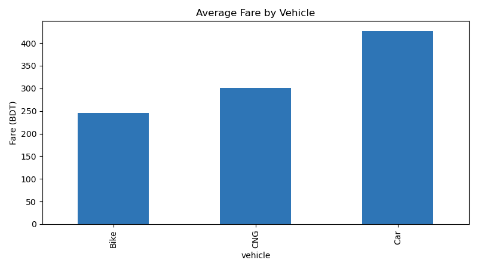
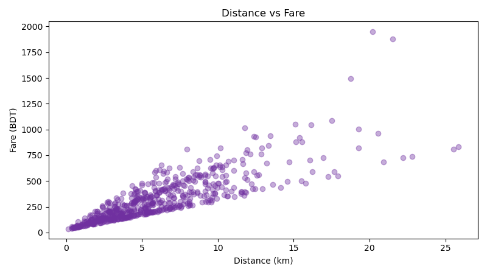
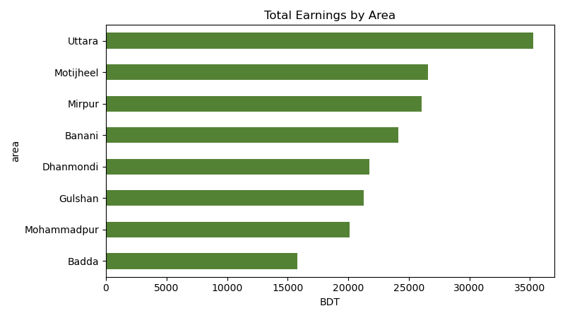
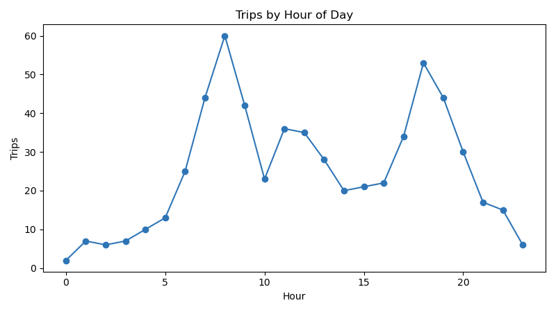

# 🛵 Dhaka Ride-Sharing Analysis

Analyzing 600 ride-sharing trips in Dhaka — fares, traffic, peak hours and earnings by area.

A complete beginner-friendly Data Science project built with **Python, Pandas, NumPy and Matplotlib**.
The dataset (600 trips) is synthetic — generated with a fixed NumPy seed so anyone can reproduce it exactly.

## What's inside
- `src/generate_dataset.py` — creates the dataset in `data/`
- `src/analysis.py` — full analysis: summary tables, charts and insights
- `dhaka-rideshare-analysis.ipynb` — Jupyter notebook version of the analysis
- `outputs/charts/` — 4 charts · `outputs/tables/` — 5 summary tables · `outputs/insights.md` — key findings
- `PROJECT_GUIDE.md` — a full beginner-friendly explanation of everything in this project

## How to run
```bash
pip install -r requirements.txt
python src/generate_dataset.py
python src/analysis.py
```

## Dataset columns
| Column | Meaning |
|---|---|
| date | Trip date |
| hour | Hour of day (0–23) |
| area | Pickup area in Dhaka |
| vehicle | Bike / Car / CNG |
| distance_km | Trip distance in km |
| duration_min | Trip duration in minutes |
| fare_bdt | Fare paid in BDT |
| surge_multiplier | Surge pricing multiplier |
| rating | Passenger rating (1–5) |

# Key Insights — Dhaka Ride-Sharing Analysis

- Dataset: 600 trips across 8 Dhaka areas.
- Highest total earnings area: **Uttara** (35,260 BDT).
- Most expensive vehicle on average: **Car** (427 BDT per trip).
- Busiest hour of the day: **8:00**.
- Correlation between distance and fare: **0.84** (fare mainly follows distance).
- Average trip rating: **4.32 / 5**.

## Charts




